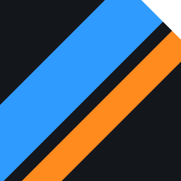
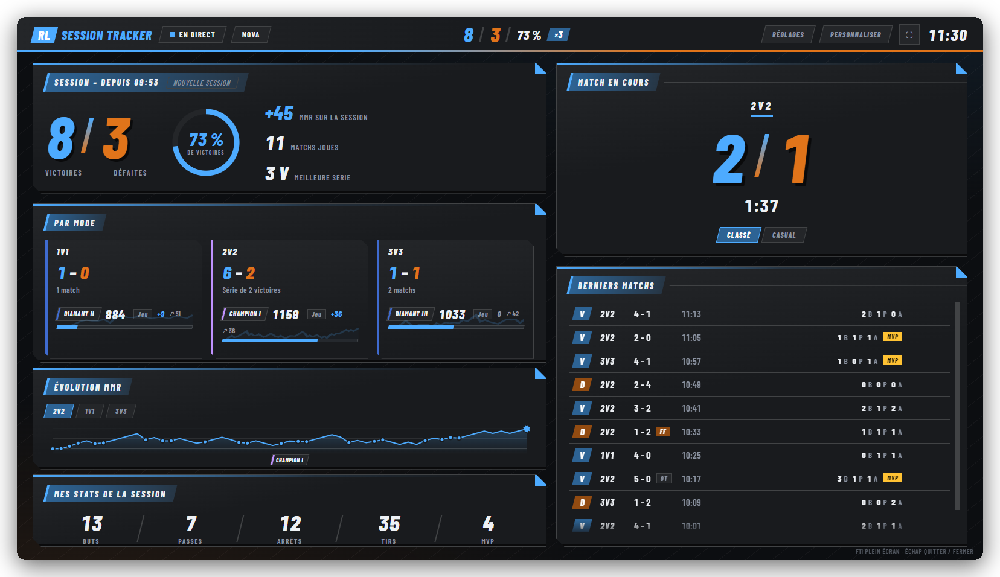
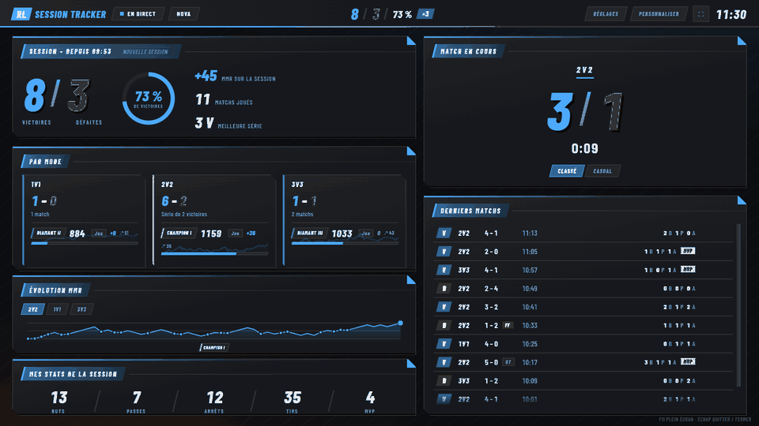
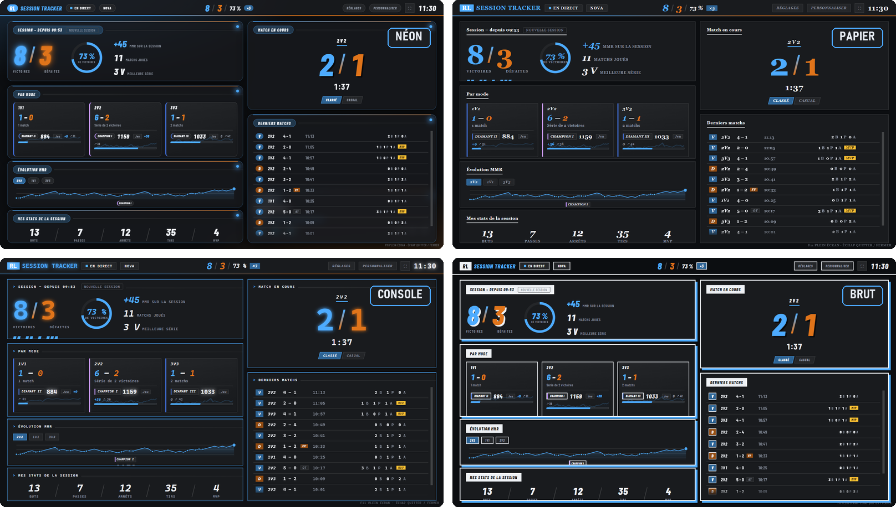
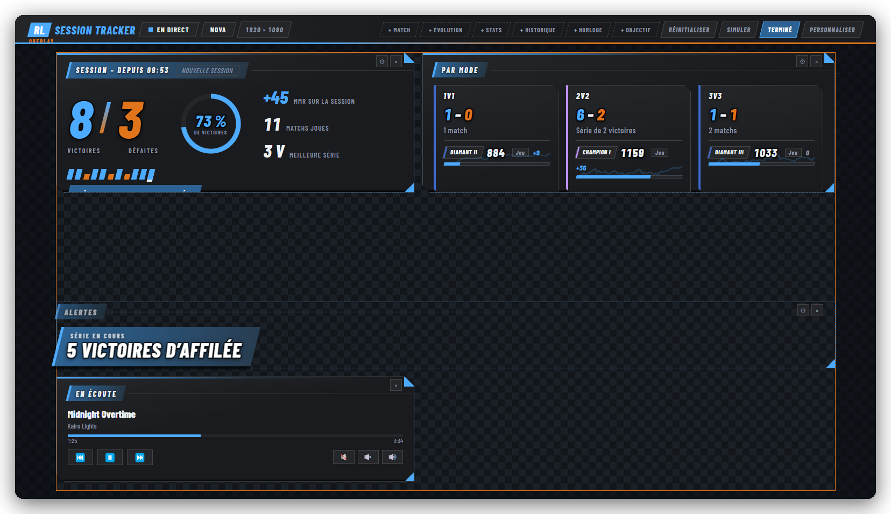
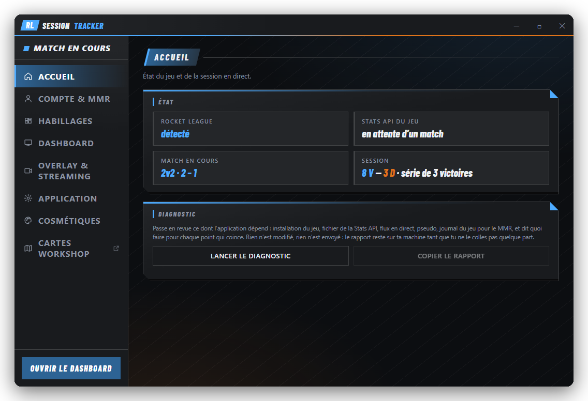
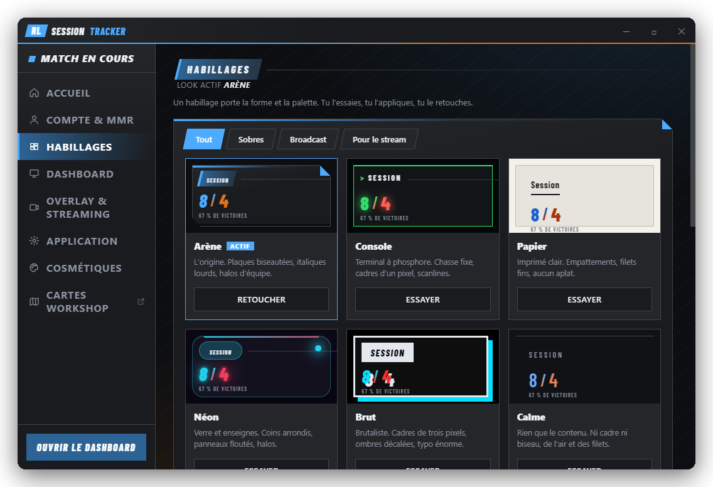
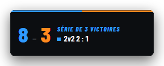
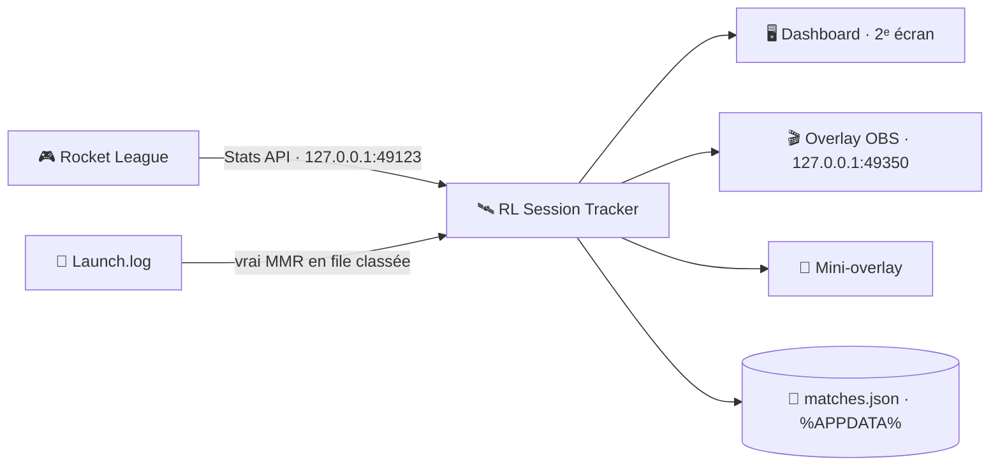

<div align="center">



# RL Session Tracker

**Ta session Rocket League, en direct sur ton deuxième écran.**

Victoires, séries, vrai MMR et stats, tirés de la Stats API officielle du jeu.<br/>
100 % local. Aucun compte. Rien d'injecté dans le jeu.

[](https://github.com/mateo-brl/rl-session-tracker/releases/latest)
[](https://github.com/mateo-brl/rl-session-tracker/actions/workflows/ci.yml)
[](LICENSE)


<a href="https://github.com/mateo-brl/rl-session-tracker/releases/latest"></a>

[English](README.md) · **Français**

<br/>



</div>

## Pourquoi

Depuis l'arrivée d'Easy Anti-Cheat dans Rocket League (avril 2026), BakkesMod et ses plugins ne tournent plus en ligne. Les trackers de session et les overlays sont partis avec.

Le jeu propose désormais une **Stats API native** : un flux local, officiel, compatible anti-triche. RL Session Tracker est construit dessus. Tu lances le jeu, ton dashboard de session s'ouvre sur ton deuxième écran. Tu quittes, il se ferme. Tes données ne quittent jamais ton PC.

## En bref

<table>
<tr>
<td width="33%" valign="top">

### 🖥️ Dashboard automatique
S'ouvre en plein écran sur ton deuxième moniteur au lancement de Rocket League, se ferme quand tu quittes. Il trouve ton pseudo tout seul après quelques matchs.

</td>
<td width="33%" valign="top">

### 📈 Vrai MMR et rang
Le jeu écrit ton vrai MMR dans son propre journal à chaque file classée. L'appli le relit, trace ta courbe et affiche ton rang avec les points restants avant le suivant.

</td>
<td width="33%" valign="top">

### ⚡ Match en direct
Score, chrono et prolongation à la seconde. Un adversaire déjà croisé ? Ton bilan contre lui s'affiche à côté de son nom.

</td>
</tr>
<tr>
<td valign="top">

### 🎬 Pensé pour le stream
Un overlay OBS transparent servi en local, composé par glisser-déposer à la taille exacte de ta scène. Bannières de victoire, flash de but et alertes inclus.

</td>
<td valign="top">

### 🎨 À ton image
Six habillages complets, huit thèmes de couleurs, des blocs déplaçables et redimensionnables, trois profils de disposition, et des looks à partager par un code.

</td>
<td valign="top">

### 🔒 Privé par conception
Pas d'inscription, pas de site tiers, pas de télémétrie. Les matchs sont stockés dans un fichier JSON local. Seule connexion sortante : la vérification des mises à jour sur GitHub.

</td>
</tr>
</table>

## Captures

### Chaque victoire a son moment



### Six habillages, pas juste six palettes

Chaque habillage change la typographie, la découpe des cartes, les filets, les ombres et le fond. Ici : Néon, Papier, Console et Brut. Arène (en haut de la page) et Calme complètent la série.



### Compose ton overlay de stream

L'overlay OBS reprend les blocs du dashboard, avec sa propre disposition. Déplace, redimensionne, masque et règle chacun sur un damier à la taille exacte de ta source, puis clique **Simuler** pour rejouer un faux match et vérifier buts, prolongation, bannières et alertes sans jouer.



### Des réglages qui ne gênent pas

<p align="center">
  
  
</p>

L'appli vit dans la zone de notification. **Ctrl+Alt+R** ouvre les réglages de n'importe où, jeu compris.

## Installation

> Nécessite **Windows 10 ou 11** et Rocket League sur **PC** (Epic Games ou Steam). La Stats API n'existe pas sur console.

1. **Télécharge** `RL-Session-Tracker-Setup-x.y.z.exe` depuis la [dernière version](https://github.com/mateo-brl/rl-session-tracker/releases/latest).
2. **Lance-le.** Si Windows SmartScreen affiche « Éditeur inconnu », clique **Informations complémentaires → Exécuter quand même**. L'installeur n'est pas signé, comme beaucoup d'applis open source gratuites.
3. Au premier lancement, **accepte la fenêtre d'autorisation Windows**. Elle active la Stats API du jeu en ajoutant une ligne à un fichier de configuration de Rocket League.
4. **Joue.** C'est tout. L'appli démarre avec Windows et se met à jour toute seule : quand une nouvelle version sort, un bouton **Mettre à jour** apparaît.

## Fonctionnalités

<details>
<summary><b>Suivi de session</b></summary>

- Victoires, défaites, % de victoires, série en cours et meilleure série, sur la session et par mode (1v1, 2v2, 3v3).
- Buts, passes, arrêts, tirs et MVP, cumulés sur la session et match par match.
- Anneau de % de victoires, vingt derniers résultats en pastilles, courbe de tendance derrière chaque tuile de mode.
- Liste des matchs récents qui repart de zéro à chaque lancement, ou d'un clic.
- Comptage honnête : un forfait adverse compte comme une victoire, quitter un match classé comme une défaite, les matchs privés sont ignorés (au choix), et un commutateur Classé/Casual garde le casual hors de ton MMR.
- Corrige n'importe quel résultat de l'historique d'un clic : stats et courbe MMR se recalculent aussitôt.
- Bilan des 7 derniers jours, records de tous les temps, export CSV.

</details>

<details>
<summary><b>MMR et rang</b></summary>

- Vrai MMR lu dans le journal du jeu (`Launch.log`) à chaque mise en file classée. Entre deux files, l'appli estime chaque match, et l'estimation se recale à chaque relevé au lieu de dériver.
- Une lecture incohérente avec tes résultats (le MMR de ton chef de groupe, par exemple) est mise de côté jusqu'à ce que la suivante la confirme.
- Si la variation réelle du MMR contredit un résultat enregistré, le forfait mal interprété est corrigé automatiquement.
- Rang déduit du MMR pour chaque playlist, avec les points restants avant le suivant.
- Tu peux toujours saisir ton MMR à la main si tu préfères.

</details>

<details>
<summary><b>Dashboard et personnalisation</b></summary>

- Chaque bloc se déplace, se redimensionne, se masque et se règle (modes affichés, lignes, colonnes, compteurs).
- Trois profils de disposition et des widgets bonus : horloge, objectif de MMR, en écoute.
- Six habillages (Arène, Console, Papier, Néon, Brut, Calme) et un atelier pour changer typographie, découpe des cartes et densité par-dessus n'importe lequel.
- Huit thèmes de couleurs ou des couleurs entièrement libres. Enregistre un look sous un nom et partage-le par un code.
- Cinq styles d'animation de fin de match, quatre jingles, et un tiltomètre après trois défaites d'affilée.
- Alertes pour les séries, les montées de rang, les MVP et les records battus.
- Mini-overlay : un petit bandeau toujours au premier plan pour jouer sur un seul écran.



</details>

<details>
<summary><b>Streaming</b></summary>

- Source Navigateur OBS locale sur `http://127.0.0.1:49350/overlay`, fond transparent, mise à jour en direct.
- Compositeur par glisser-déposer à la taille de ta scène OBS (1920 × 1080 par défaut). Export et import de presets.
- L'ancien bandeau compact reste disponible sur `/classic`.
- Pont optionnel qui réémet le flux du jeu sur `ws://127.0.0.1:49122` au format de l'ancien plugin SOS : les overlays de diffusion écrits pour lui refonctionnent sans modification.
- Statut Discord (optionnel) : tes amis voient « Classé 2v2 · 3 – 2 » et ta série.
- Bloc « En écoute » : affiche et pilote ce qui joue sur ton PC (Spotify, un onglet de navigateur, VLC…) via les contrôles média de Windows. Sans clé d'API, sans compte.

</details>

<details>
<summary><b>Outils et extras</b></summary>

- **Diagnostic** : vérifie les installations du jeu, le fichier de la Stats API et les droits d'écriture dessus, le flux en direct, le journal du jeu et ton pseudo, puis dit quoi corriger. « Copier le rapport » en donne une version texte.
- **Bilingue** : français et anglais, selon la langue du système.
- **Cartes workshop (Epic)** : parcours [bakkesplugins.com/maps](https://bakkesplugins.com/maps) dans une fenêtre de l'appli, télécharge une carte et charge-la sur l'une des quatre arènes Labs pour l'Entraînement libre. Les originaux sont sauvegardés et remis d'un clic, et les arènes qui peuvent tomber en ligne reviennent d'origine dès que tu lances une recherche.
- **Alpha Boost visuel** : optionnel, voir l'avertissement ci-dessous.

</details>

> [!WARNING]
> Les cartes workshop et le swap de boost sont les **seules** fonctionnalités qui modifient des fichiers de Rocket League. Elles ne font rien tant que tu ne t'en sers pas, jamais pendant que le jeu tourne, sauvegardent les originaux et se restaurent d'un clic (« Vérifier l'intégrité des fichiers » remet aussi tout d'origine). Aucun ban signalé depuis Easy Anti-Cheat, mais modifier les fichiers du jeu est contraire à la lettre de ses conditions d'utilisation. À toi de voir.

## Comment ça marche



Tout tourne sur ton PC. Le tracker écoute le socket local de la Stats API et relit le journal du jeu depuis l'extérieur du processus : aucune injection, aucune lecture mémoire, rien qui puisse déranger l'anti-triche. L'historique des matchs est dans `%APPDATA%\RL Session Tracker`.

| | RL Session Tracker | Sites de tracking | Plugins BakkesMod |
|---|:---:|:---:|:---:|
| En direct pendant le match | ✅ | ❌ après coup | ✅ |
| Compatible Easy Anti-Cheat | ✅ | ✅ | ❌ bloqué en ligne |
| 100 % local, sans compte | ✅ | ❌ | ✅ |
| Dashboard 2ᵉ écran automatique | ✅ | ❌ | ❌ |

## FAQ

<details>
<summary><b>Le dashboard ne montre rien pendant mes matchs</b></summary>

La Stats API est sans doute désactivée. Ouvre l'appli (icône de notification ou Ctrl+Alt+R), clique **Réactiver la Stats API du jeu**, accepte la fenêtre Windows et **redémarre Rocket League**. Le diagnostic intégré indique ce qui coince. En dernier recours : lance `enable-statsapi.bat` depuis ce dépôt.
</details>

<details>
<summary><b>Mes victoires et défaites ne sont pas comptées</b></summary>

L'appli ne connaît pas encore ton pseudo. Joue deux ou trois matchs (tu es le seul joueur présent dans tous) ou choisis ton pseudo dans les suggestions des réglages.
</details>

<details>
<summary><b>Ça marche avec Steam ?</b></summary>

Oui, exactement comme avec Epic. Les deux installations sont détectées automatiquement, y compris les bibliothèques Steam sur un autre disque. Une « Vérification de l'intégrité » Steam ou une grosse mise à jour peut réinitialiser le fichier de la Stats API : l'appli le contrôle à chaque lancement et le réactive (une fenêtre admin à accepter). Elle pose aussi un `TAStatsAPI.ini` dans tes Documents, qui survit aux mises à jour et aux vérifications.
</details>

<details>
<summary><b>Le mini-overlay n'apparaît pas par-dessus le jeu</b></summary>

En plein écran exclusif, Windows ne laisse aucune fenêtre passer devant le jeu (c'est pareil pour tous les overlays). Passe Rocket League en **Fenêtré sans bordure** dans Paramètres → Vidéo. Le rendu est identique.
</details>

<details>
<summary><b>Le dashboard s'ouvre sur le mauvais écran</b></summary>

Il choisit automatiquement ton écran secondaire. Désactive « plein écran » dans les réglages pour avoir une fenêtre normale à placer où tu veux.
</details>

<details>
<summary><b>Mon MMR est-il exact ?</b></summary>

Le jeu l'écrit dans son journal quand tu lances une file classée, et l'appli se recale à chaque relevé. Deux limites : rien n'est écrit quand tu n'es pas chef de groupe, et le dernier match d'une session n'est confirmé qu'à ta prochaine file. Pendant les matchs de placement les gains sont plus gros, l'estimation peut donc dériver jusqu'à la fin des placements. Si Psyonix change le format du journal, l'appli revient simplement à l'estimation seule.
</details>

## Compiler depuis les sources

Application Electron, un seul processus principal, fenêtres HTML/CSS/JS sans framework, aucune étape de build.

```bash
git clone https://github.com/mateo-brl/rl-session-tracker.git
cd rl-session-tracker
npm install
npm start        # lance l'appli
npm test         # tests unitaires et d'intégration (node --test)
npm run smoke    # test de fumée : la vraie appli dans Electron
npm run dist     # construit l'installeur Windows dans dist/
```

Les versions sont construites par GitHub Actions ([release.yml](.github/workflows/release.yml)) sur un tag `v*`, un lancement manuel, ou un commit sur `main` contenant `[release]`. Les applis installées récupèrent la nouvelle version automatiquement via `latest.yml`.

<details>
<summary>Structure du projet</summary>

```
src/
├── main/                 processus principal Electron
│   ├── index.js          cycle de vie, état partagé, câblage
│   ├── statsapi.js       connecteur Stats API (parseur du flux TCP)
│   ├── session.js        journal des matchs, stats, courbe MMR, records
│   ├── rl-log.js         vrai MMR et playlist lus dans Launch.log
│   ├── mmr-guard.js      met de côté les relevés de MMR incohérents
│   ├── obs-server.js     overlay OBS local (SSE)
│   ├── sos-bridge.js     pont WebSocket compatible SOS
│   ├── discord-rpc.js    statut Discord (IPC local)
│   ├── diagnostic.js     contrôles derrière le bouton Diagnostic
│   └── …                 mises à jour, zone de notification, fenêtres, cartes, cosmétiques
├── preload.js            pont IPC sécurisé (contextIsolation)
└── renderer/             fenêtres réglages, dashboard, overlay, OBS et cartes
test/                     suites node --test
e2e/smoke.js              test de fumée de bout en bout dans Electron
```

</details>

## Licence

[MIT](LICENSE). La police Barlow Condensed est sous licence SIL Open Font License 1.1. Projet indépendant, non affilié à Psyonix ni à Epic Games.

<div align="center">
<br/>

**Ça te plaît ? Une ⭐ aide d'autres joueurs à le trouver.**

</div>
