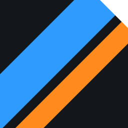
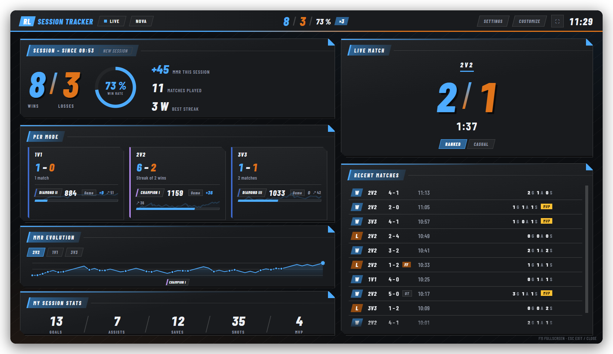
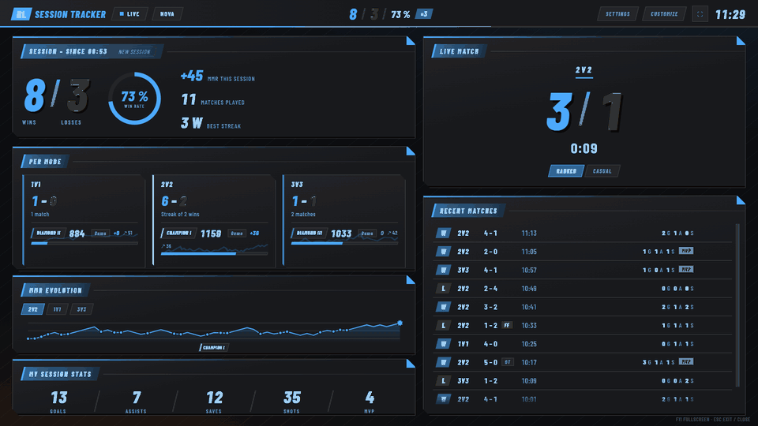
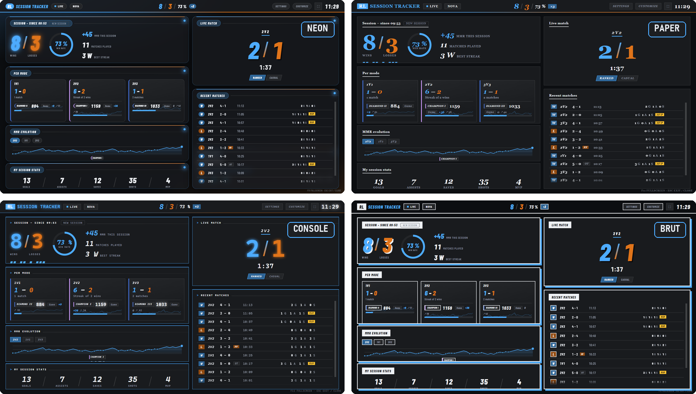
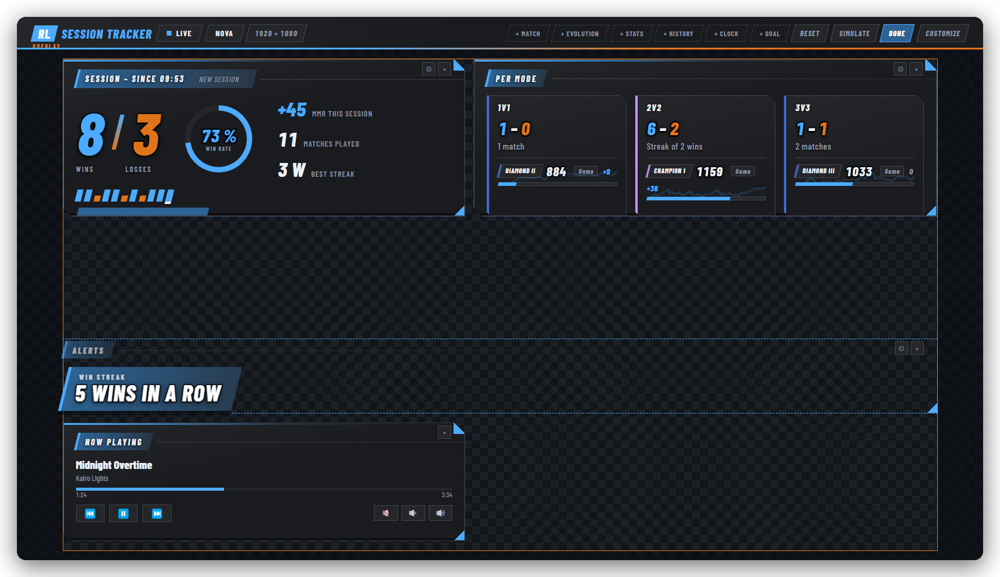
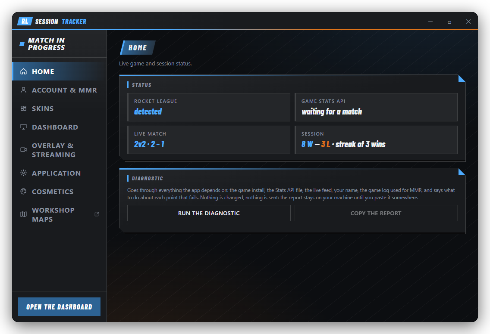
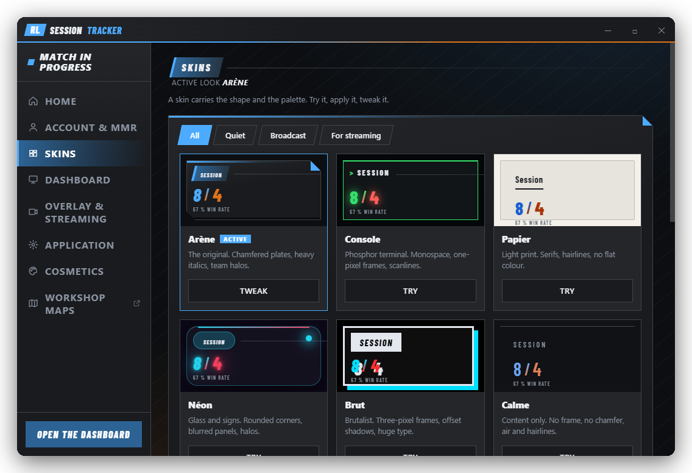
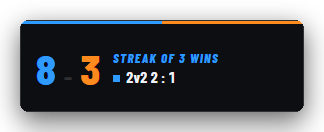
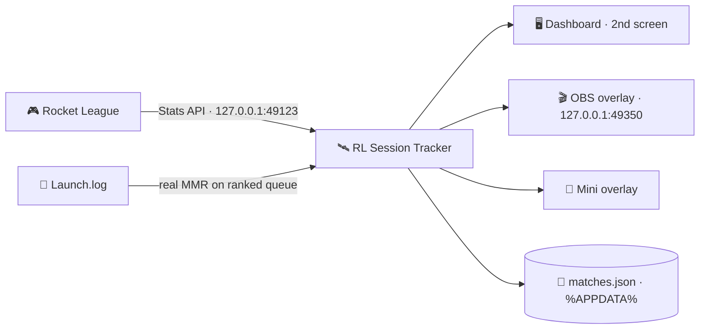

<div align="center">



# RL Session Tracker

**Your Rocket League session, live on your second screen.**

Wins, streaks, real MMR and stats, straight from the game's official Stats API.<br/>
100% local. No account. Nothing injected into the game.

[](https://github.com/mateo-brl/rl-session-tracker/releases/latest)
[](https://github.com/mateo-brl/rl-session-tracker/actions/workflows/ci.yml)
[](LICENSE)


<a href="https://github.com/mateo-brl/rl-session-tracker/releases/latest"></a>

**English** · [Français](README.fr.md)

<br/>



</div>

## Why

Since Easy Anti-Cheat arrived in Rocket League (April 2026), BakkesMod and its plugins no longer run online. That took session trackers and overlays with them.

The game now ships a **native Stats API**: a local feed, official and anti-cheat friendly. RL Session Tracker is built on it. Launch the game and your session dashboard opens on your second screen. Close the game and it goes away. Your data never leaves your PC.

## Highlights

<table>
<tr>
<td width="33%" valign="top">

### 🖥️ Hands-free dashboard
Opens fullscreen on your second monitor when Rocket League starts, closes when you quit. It finds your in-game name by itself after a couple of matches.

</td>
<td width="33%" valign="top">

### 📈 Real MMR and rank
The game writes your true MMR to its own log every time you queue ranked. The app reads it, draws your curve and shows your rank and the points left to the next one.

</td>
<td width="33%" valign="top">

### ⚡ Live match
Score, clock and overtime to the second. Facing someone you've played before? Your record against them shows up next to their name.

</td>
</tr>
<tr>
<td valign="top">

### 🎬 Built for streaming
A transparent OBS overlay served locally, laid out in a drag-and-drop composer at your exact canvas size. Win banners, goal flashes and alerts included.

</td>
<td valign="top">

### 🎨 Make it yours
Six complete skins, eight color themes, movable and resizable blocks, three layout profiles, and looks you can share with a code.

</td>
<td valign="top">

### 🔒 Private by design
No sign-up, no third-party site, no telemetry. Matches are stored in a local JSON file. The only outbound request is the update check on GitHub.

</td>
</tr>
</table>

## Screenshots

### Every win gets its moment



### Six skins, not just six palettes

Each skin changes the typography, card shapes, borders, shadows and background. Shown here: Neon, Paper, Console and Brut. Arena (top of the page) and Calm complete the set.



### Compose your stream overlay

The OBS overlay uses the same blocks as the dashboard, with its own layout. Move, resize, hide and configure each one over a checkerboard at your source's exact size, then press **Simulate** to replay a fake match and check goals, overtime, banners and alerts without playing.



### Settings that stay out of the way

<p align="center">
  
  
</p>

The app lives in the system tray. **Ctrl+Alt+R** opens the settings from anywhere, in-game included.

## Install

> Requires **Windows 10 or 11** and Rocket League on **PC** (Epic Games or Steam). The Stats API does not exist on consoles.

1. **Download** `RL-Session-Tracker-Setup-x.y.z.exe` from the [latest release](https://github.com/mateo-brl/rl-session-tracker/releases/latest).
2. **Run it.** If Windows SmartScreen says "Unknown publisher", click **More info → Run anyway**. The installer is not code-signed, which is common for free open-source apps.
3. On first launch, **accept the Windows permission prompt**. It enables the game's Stats API by writing one line to a Rocket League config file.
4. **Play.** That's it. The app starts with Windows and updates itself: when a new version ships, an **Update** button appears.

## Features

<details>
<summary><b>Session tracking</b></summary>

- Wins, losses, win rate, current and best streak, for the whole session and per mode (1v1, 2v2, 3v3).
- Goals, assists, saves, shots and MVPs, as session totals and match by match.
- Win-rate ring, last twenty results as pips, trend curve behind each mode tile.
- Recent matches list that starts fresh on each launch, or with one click.
- Fair counting: an opponent forfeit counts as a win, leaving a ranked match as a loss, private matches are ignored (optional), and a Ranked/Casual switch keeps casual games out of your MMR.
- Fix any result from the history in one click: stats and the MMR curve recalculate instantly.
- Seven-day summary, all-time records, CSV export.

</details>

<details>
<summary><b>MMR and rank</b></summary>

- True MMR read from the game's own log (`Launch.log`) each time you queue ranked. Between two queues the app estimates each match, and the estimate is re-anchored on every reading instead of drifting.
- Readings that don't fit your results (your party leader's MMR, for example) are set aside until the next one confirms them.
- If the real MMR change contradicts a recorded result, the misread forfeit is fixed automatically.
- Rank derived from MMR for each playlist, with the points left to the next one.
- You can still type your MMR by hand if you prefer.

</details>

<details>
<summary><b>Dashboard and customization</b></summary>

- Every block can be moved, resized, hidden and configured (modes shown, rows, columns, counters).
- Three layout profiles and bonus widgets: clock, MMR goal, now playing.
- Six skins (Arena, Console, Paper, Neon, Brut, Calm) plus a workshop to change typography, card cut and density on top of any skin.
- Eight color themes or fully custom colors. Save a look under a name and share it as a code.
- Five end-of-match animation styles, four jingles, and a tilt-o-meter after three losses in a row.
- Alerts for win streaks, rank ups, MVPs and broken records.
- Mini overlay: a small always-on-top strip for single-screen setups.



</details>

<details>
<summary><b>Streaming</b></summary>

- Local OBS Browser source at `http://127.0.0.1:49350/overlay`, transparent background, updated live.
- Drag-and-drop composer working at your OBS canvas size (1920 × 1080 by default). Export and import presets.
- Classic compact bar still available at `/classic`.
- Optional bridge that re-broadcasts the game feed on `ws://127.0.0.1:49122` in the format of the old SOS plugin, so broadcast overlays written for it work again unchanged.
- Discord Rich Presence (optional): friends see "Ranked 2v2 · 3 – 2" and your streak.
- Now playing block: shows and controls whatever plays on your PC (Spotify, a browser tab, VLC…) through Windows' media controls. No API key, no account.

</details>

<details>
<summary><b>Tools and extras</b></summary>

- **Diagnostic**: checks game installs, the Stats API file and write access to it, the live feed, the game log and your name, then tells you what to fix. "Copy the report" gives a text version.
- **Bilingual**: English and French, picked from your system language.
- **Workshop maps (Epic)**: browse [bakkesplugins.com/maps](https://bakkesplugins.com/maps) in an app window, download a map and load it on one of up to four Labs arenas for Free Play. Originals are backed up and restored in one click, and arenas that can show up online are restored as soon as you queue.
- **Alpha Boost visual swap**: optional, see the warning below.

</details>

> [!WARNING]
> Workshop maps and the boost swap are the **only** features that modify Rocket League files. They do nothing until you use them, never run while the game is open, back up the originals and restore in one click ("Verify integrity of game files" also restores everything). No ban has been reported since Easy Anti-Cheat, but modifying game files is against the letter of the game's terms. Your call.

## How it works



Everything runs on your PC. The tracker listens to the game's local Stats API socket and reads the game's log file from outside the game process: no injection, no memory reading, nothing for the anti-cheat to object to. Match history lives in `%APPDATA%\RL Session Tracker`.

| | RL Session Tracker | Tracking websites | BakkesMod plugins |
|---|:---:|:---:|:---:|
| Live during the match | ✅ | ❌ after the fact | ✅ |
| Works with Easy Anti-Cheat | ✅ | ✅ | ❌ blocked online |
| 100% local, no account | ✅ | ❌ | ✅ |
| Automatic second-screen dashboard | ✅ | ❌ | ❌ |

## FAQ

<details>
<summary><b>The dashboard shows nothing during my matches</b></summary>

The Stats API is probably off. Open the app (tray icon or Ctrl+Alt+R), click **Re-enable the game's Stats API**, accept the Windows prompt and **restart Rocket League**. The built-in diagnostic points to what is wrong. Last resort: run `enable-statsapi.bat` from this repository.
</details>

<details>
<summary><b>My wins and losses aren't counted</b></summary>

The app doesn't know your name yet. Play two or three matches (you're the only player present in all of them) or pick your name from the suggestions in the settings.
</details>

<details>
<summary><b>Does it work with Steam?</b></summary>

Yes, exactly like Epic. Both installs are detected automatically, including Steam libraries on other drives. A Steam "Verify integrity" or a big game update can reset the Stats API file: the app checks it on every launch and re-enables it (one admin prompt). It also writes a `TAStatsAPI.ini` in your Documents folder, which survives updates and verifications.
</details>

<details>
<summary><b>The mini overlay doesn't show above the game</b></summary>

In exclusive fullscreen, Windows lets no window appear over the game (this applies to every overlay). Switch Rocket League to **Borderless Windowed** in Settings → Video. It looks the same.
</details>

<details>
<summary><b>The dashboard opens on the wrong screen</b></summary>

It picks your secondary display automatically. Turn off "fullscreen" in the settings to get a normal window you can place anywhere.
</details>

<details>
<summary><b>Is my MMR exact?</b></summary>

The game writes it to its log when you queue ranked, and the app re-anchors on every reading. Two limits: nothing is logged when you're not the party leader, and the last match of a session is only confirmed at your next queue. During placement matches gains are bigger, so expect some drift until placements end. If Psyonix changes the log format, the app falls back to estimating on its own.
</details>

## Build from source

Electron app, one main process, framework-free HTML/CSS/JS windows, no build step.

```bash
git clone https://github.com/mateo-brl/rl-session-tracker.git
cd rl-session-tracker
npm install
npm start        # run the app
npm test         # unit and integration tests (node --test)
npm run smoke    # smoke test: the real app inside Electron
npm run dist     # build the Windows installer into dist/
```

Releases are built by GitHub Actions ([release.yml](.github/workflows/release.yml)) on a `v*` tag, a manual run, or a `main` commit containing `[release]`. Installed apps pick up the new version automatically through `latest.yml`.

<details>
<summary>Project layout</summary>

```
src/
├── main/                 Electron main process
│   ├── index.js          lifecycle, shared state, wiring
│   ├── statsapi.js       Stats API connector (TCP stream parser)
│   ├── session.js        match log, stats, MMR curve, records
│   ├── rl-log.js         real MMR and playlist from Launch.log
│   ├── mmr-guard.js      keeps implausible MMR readings aside
│   ├── obs-server.js     local OBS overlay (SSE)
│   ├── sos-bridge.js     SOS-compatible WebSocket bridge
│   ├── discord-rpc.js    Discord Rich Presence (local IPC)
│   ├── diagnostic.js     health checks behind the Diagnostic button
│   └── …                 updater, tray, windows, maps, cosmetics
├── preload.js            secure IPC bridge (contextIsolation)
└── renderer/             control, dashboard, overlay, OBS and maps windows
test/                     node --test suites
e2e/smoke.js              end-to-end smoke test in real Electron
```

</details>

## License

[MIT](LICENSE). The Barlow Condensed font is licensed under the SIL Open Font License 1.1. Not affiliated with or endorsed by Psyonix or Epic Games.

<div align="center">
<br/>

**Like it? A ⭐ helps other players find it.**

</div>
